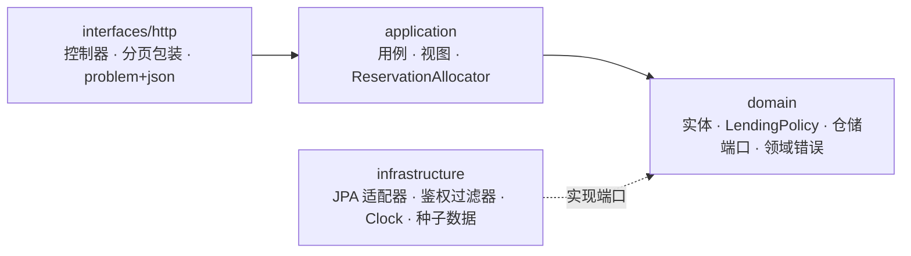
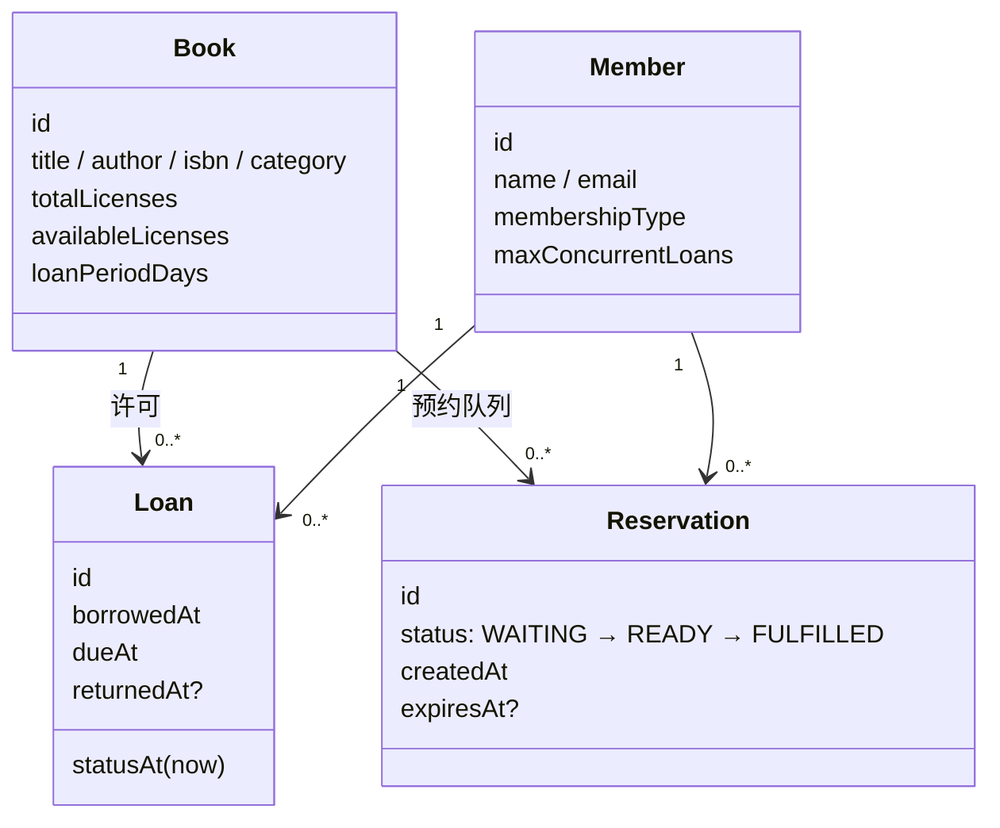
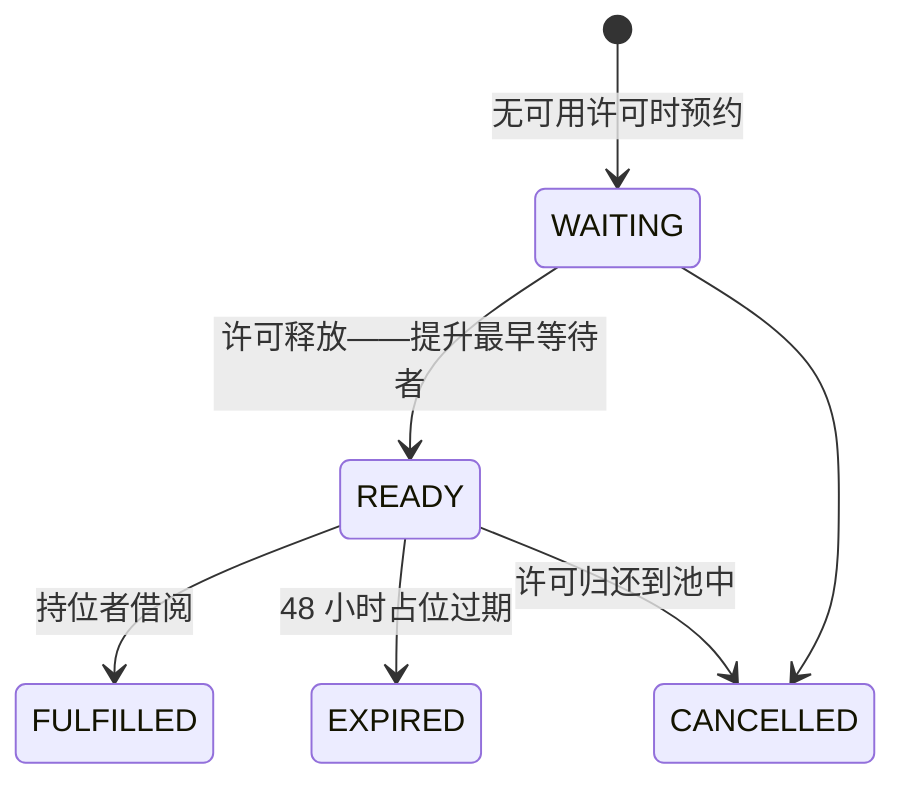

# 电子图书馆服务（E-Library Service）

一个面向数字图书馆的小型后端服务：浏览书目、借阅与归还带许可（license）的电子书，并在所有许可都被占用时加入预约队列。

本项目为后端 take-home 作业，因此重点在于应用架构、领域建模、API 设计、错误处理以及显式的设计取舍，而非功能广度。

- Java 17、Spring Boot 3.3、Spring Data JPA、SQLite、springdoc-openapi
- 37 个测试：领域单元测试、基于真实 SQLite 数据库的 HTTP 集成测试，以及针对「争抢最后一个许可」的并发测试

---

## 快速开始

前置条件：JDK 17+、Maven 3.8+（使用更高版本的 JDK 也能正常构建）。

```bash
export JAVA_HOME=$(/usr/libexec/java_home -v 17)   # 本机默认 JDK 为 8
mvn spring-boot:run
```

也可以先构建 jar：

```bash
mvn -DskipTests package
java -jar target/e-library-1.0.0.jar
```

服务监听 `http://localhost:8080`；数据库文件会创建在 `./data/elibrary.db`（可通过 `ELIBRARY_DB_PATH` 覆盖）。首次启动时会自动写入演示数据。

- 交互式 API 文档：http://localhost:8080/swagger-ui.html
- OpenAPI JSON：http://localhost:8080/v3/api-docs

### 演示凭证

鉴权被刻意简化：一个不透明的 bearer token 即可标识一个预置会员。

| Token | 会员 | 最大并发借阅数 |
| --- | --- | --- |
| `token-alice` | Alice Chen（PREMIUM） | 5 |
| `token-bob` | Bob Lin（BASIC） | 3 |
| `token-carol` | Carol Wu（BASIC） | 1 |

```bash
curl "http://localhost:8080/api/v1/books?q=clean&size=5"

curl -X POST "http://localhost:8080/api/v1/books/<bookId>/loans" \
     -H "Authorization: Bearer token-alice"

curl -X POST "http://localhost:8080/api/v1/loans/<loanId>/return" \
     -H "Authorization: Bearer token-alice"

curl "http://localhost:8080/api/v1/me/loans?status=active" \
     -H "Authorization: Bearer token-alice"

curl -X POST "http://localhost:8080/api/v1/books/<bookId>/reservations" \
     -H "Authorization: Bearer token-bob"
```

---

## 架构

四层结构，依赖只允许由外向内：



- **domain** — 携带自身不变量的实体、纯函数式的 `LendingPolicy`、仓储接口以及业务错误类型。它不感知 HTTP、Spring Data 或 SQL。
- **application** — 每个业务操作对应一个用例。每个 public 方法恰好是一个事务边界，因此一致性范围一目了然，也易于测试。
- **infrastructure** — 仓储适配器（Spring Data JPA）、Token 鉴权、可注入的 `Clock`，以及演示数据初始化。
- **interfaces/http** — 轻量控制器、分页包装、当前会员的参数解析器，以及一个全局异常处理器。

为什么不再多做一层？CQRS、事件溯源、读写分离或微服务都会增加活动部件，却无法改变这里的任何一个需求。上述分层是「让领域规则可被独立测试、让持久化与传输层可被替换」的最小结构。

### 代码组织

```
src/main/java/com/elibrary/
├── domain/
│   ├── model/            Book、Member、Loan、Reservation（+ 状态枚举、转换器）
│   ├── repository/       端口、搜索条件、排序/过滤枚举、PageQuery/PageResult
│   ├── service/          LendingPolicy
│   └── exception/        DomainException 体系 + ErrorCode
├── application/
│   ├── usecase/          BrowseBooks、GetBookDetail、BorrowBook、ReturnLoan 等
│   ├── service/          ReservationAllocator（队列提升 / 占位过期）
│   └── view/             面向 API 的视图记录
├── infrastructure/
│   ├── persistence/      JPA 仓储、适配器、DatabaseSeeder
│   ├── auth/             bearer-token 过滤器、MemberPrincipal
│   └── ClockConfig
└── interfaces/http/      控制器、PageResponse、RequestIdFilter、错误处理、OpenAPI
```

---

## 领域模型



电子书不是实体副本，因此不存在 `BookCopy` 实体。真正约束借阅的是**并发许可数**，这也是为什么 `Book` 持有许可计数，而 `Loan` / `Reservation` 作为独立聚合，通过 id 引用图书与会员。

### 业务规则

1. 一本书的活跃借阅数永远不会超过 `totalLicenses`。
2. 同一会员不能同时持有同一本书的两笔活跃借阅（SQLite 的部分唯一索引也会强制这一点）。
3. 会员的活跃借阅数不能超过 `maxConcurrentLoans`。
4. 只有借阅者本人可以归还该笔借阅。
5. `dueAt = borrowedAt + loanPeriodDays`；**逾期状态是派生值**（`dueAt < now && returnedAt == null`），从不落库——因而不存在因定时任务失败而留下过期状态的可能。
6. 只有在无可用许可时才允许创建预约。
7. READY 状态的占位会消耗一个许可，并在 48 小时后过期（可配置）。

---

## 许可模型与并发

这是朴素实现最容易出问题的部分：两名会员同时借最后一本时，绝不能都成功。

许可计数从不在 Java 侧做「读取-修改-写回」，而是由仓储发出**条件更新**：

```sql
UPDATE books
   SET available_licenses = available_licenses - 1
 WHERE id = :id AND available_licenses > 0;
```

`rowsAffected == 0` 表示「已无可用许可」，转化为 `409 BOOK_UNAVAILABLE`。正确性来自数据库语句本身，而不是应用层的 `if` 判断或 JVM 锁，因此在多实例部署下依然成立。`CHECK (available_licenses BETWEEN 0 AND total_licenses)` 约束与活跃借阅上的部分唯一索引构成最后一道防线。

不变量：`availableLicenses + activeLoans + readyHolds == totalLicenses`，由集成测试断言。

SQLite 是单写者数据库。为避免 `SQLITE_BUSY` 升级错误，Hikari 连接池被限制为 1 个连接；API 仍然能并发响应请求，只是它们会在连接处排队。这是一个刻意的部署取舍，已在 `application.yml` 中注明。迁移到 PostgreSQL 只需改配置——同样的条件更新依然正确，并且允许真正的并行写入。如果吞吐量成为问题，下一步是针对序列化失败做短重试，并为浏览查询增加只读副本。

---

## 预约



- 提升按 `createdAt` 先进先出，并以原子方式占用一个许可，因此队列不会超额分配。
- 过期是**惰性**的：在预约相关操作的开始处（以及 `GET /me/reservations` 时）求值，而不是依赖后台调度器。这让服务不需要任何后台基础设施；后续可在不改变模型的前提下加入定时清理任务。
- 已持有该书的会员不能预约；当仍有可用许可时也不能创建预约——这些请求会带明确错误码被拒绝，调用方据此知道该怎么做。

---

## API

基础路径 `/api/v1`。JSON 输入输出，camelCase，UTC ISO-8601 时间戳。

| 方法 | 路径 | 鉴权 | 用途 |
| --- | --- | --- | --- |
| `GET` | `/books?q=&category=&availableOnly=&sort=&page=&size=` | – | 浏览 / 检索书目 |
| `GET` | `/books/{bookId}` | 可选 | 图书详情，认证后返回 `borrowedByMe` |
| `POST` | `/books/{bookId}/loans` | ✔ | 借阅（201 + `Location`） |
| `POST` | `/loans/{loanId}/return` | ✔ | 归还（幂等） |
| `GET` | `/me/loans?status=all\|active\|overdue\|returned` | ✔ | 我的借阅 |
| `POST` | `/books/{bookId}/reservations` | ✔ | 加入预约队列（201 + `Location`） |
| `GET` | `/me/reservations?status=` | ✔ | 我的预约 |
| `DELETE` | `/reservations/{reservationId}` | ✔ | 取消预约 |

设计说明：

- `sort` 支持 `title`（默认）、`publishedYear`、`newest`。`page` 从 0 开始，`size` 取值 1–100。
- 分页响应结构为 `{ items, page, size, totalElements, totalPages }`。
- 使用 `/me/...` 而非 `/members/{id}/...`：授权规则变得极其简单，且从结构上杜绝了跨会员越权访问。
- 借阅**不是**幂等的（重复借阅返回 409 `DUPLICATE_LOAN`）；归还是**幂等**的（重复归还返回 200 与原始 `returnedAt`），因为超时后重试归还是安全且常见的。
- 分页采用 offset 方式，以保持简单；若书目增长到几十万量级，则应改为游标分页。

### 错误契约

所有失败均使用 `application/problem+json`（RFC 7807 风格），并携带稳定的 `code`：

```json
{
  "type": "https://elibrary.local/errors/book-unavailable",
  "title": "Conflict",
  "status": 409,
  "code": "BOOK_UNAVAILABLE",
  "detail": "All licenses for book ... are currently in use",
  "instance": "/api/v1/books/.../loans",
  "requestId": "6b31f84b-eef8-4929-bce3-e2fb0648318a"
}
```

| HTTP | 错误码 |
| --- | --- |
| 400 | `VALIDATION_FAILED`、`INVALID_REQUEST` |
| 401 | `UNAUTHORIZED` |
| 403 | `LOAN_NOT_OWNED`、`RESERVATION_NOT_OWNED` |
| 404 | `BOOK_NOT_FOUND`、`LOAN_NOT_FOUND`、`RESERVATION_NOT_FOUND` |
| 409 | `BOOK_UNAVAILABLE`、`DUPLICATE_LOAN`、`LOAN_LIMIT_REACHED`、`RESERVATION_EXISTS`、`BOOK_AVAILABLE`、`RESERVATION_NOT_CANCELLABLE`、`CONFLICT` |
| 500 | `INTERNAL_ERROR`（日志中带 `requestId`，绝不泄露细节） |

校验的分工：Bean Validation 守住传输边界（类型、范围、非法 JSON），领域代码再次校验不变量，从而无论调用方是谁都能保持正确。未预期的异常会带上关联 id 记录日志，客户端只会看到通用的 problem 文档。

---

## 持久化

数据库 schema 采用显式 SQL（`src/main/resources/schema.sql`），而非 Hibernate 自动生成 DDL，因为关键的保证就落在 schema 上：

- `ux_loans_active_title`：`(book_id, member_id) WHERE returned_at IS NULL` 上的部分唯一索引
- `ux_reservations_active_title`：`(book_id, member_id) WHERE status IN ('WAITING', 'READY')` 上的部分唯一索引
- 许可计数与借阅期限上的 `CHECK` 约束
- 队列（`book_id, status, created_at`）与会员历史所需的索引

时间戳通过 JPA `AttributeConverter` 以 ISO-8601 UTC 文本存储——SQLite 没有时间戳类型，而固定格式既保持可读又可排序。按时间的排序/过滤在 Java 侧对有限集合完成（会员的活跃借阅、READY 占位），而不是依赖特定方言的日期 SQL。

`ddl-auto` 已禁用；Hibernate 仅用于对象映射与脏检查。

---

## 测试

```bash
mvn test
```

- **单元测试**（`domain/model`、`domain/service`）：到期日与逾期派生、归还幂等保护、预约状态机、借阅上限。不启动 Spring 上下文。
- **集成测试**（`api/*Test`）：每个测试上下文使用一个一次性 SQLite 文件启动完整应用，通过 MockMvc 驱动。覆盖检索/过滤/分页、404、授权、重复/超限/无可用许可等冲突、幂等归还、逾期过滤、预约提升、取消、惰性过期。
- **并发测试**（`BorrowConcurrencyTest`）：8 个线程争抢 1 个许可；恰好 1 个成功，7 个收到 `BOOK_UNAVAILABLE`，数据库最终只有 1 笔活跃借阅。

---

## 假设

- 图书馆按并发许可出借数字内容；没有实体副本，也不提供逐页内容下发（仅元数据）。
- 鉴权是演示用的 bearer-token 适配器。真实部署会接入身份提供方；`@CurrentMember` 解析器与 `MemberPrincipal` 就是替换的接缝。
- 不做罚金、书评、后台 CRUD、邮件通知、刷新令牌——均在范围之外。
- 借阅期限按书配置（演示数据为 14 天或 21 天）。
- 会员仅可在无可用许可时预约；占位有效期为 48 小时。
- 时间统一为 UTC；每个请求的「当前时间」都来自注入的 `Clock`。

## 刻意的设计取舍

| 决策 | 备选方案 | 理由 |
| --- | --- | --- |
| JPA 实体同时充当领域模型 | 独立的持久化实体 + 映射层 | 4–6 小时的作业范围内，映射样板代码只增加风险而不改变行为。仓储端口仍将用例与 JPA 隔离。 |
| 冗余许可计数 + 条件更新 | 每次借阅 `COUNT(active loans)` | 时间复杂度 O(1)、并发下原子、不依赖隔离级别。不变量由测试断言。 |
| SQLite 上 Hikari 连接池设为 1 | 更大的连接池 + `SQLITE_BUSY` 重试 | 消除一类升级死锁；已注明这是部署相关的取舍。换成 PostgreSQL 后该限制自然消失。 |
| 归还幂等 | 重复归还返回 409 | 超时后的客户端重试是安全的。 |
| 占位惰性过期 | 定时任务 / TTL 存储 | 不需要后台基础设施；在下一次读写时自愈。 |
| Offset 分页 | 游标分页 | 契约更简单；当前书目规模尚不足以支撑游标。 |
| 仅在无可用许可时允许预约 | 任何时候都允许预约 | 每个状态只有一条清晰路径，避免意图歧义。 |
| 不使用 `@Version` 乐观锁 | 版本号列 | 条件更新已使临界区安全；版本检查只会成为噪声。 |

## 如果投入生产

- 用 PostgreSQL 替换 SQLite，引入 Flyway 迁移，并为浏览查询增加只读副本。
- 接入真实的 OIDC/JWT 鉴权，并提供按角色划分的书目管理后台接口。
- 增加许可计数的定时对账，以及计数漂移的指标与告警。
- 用定时清理任务替代惰性过期，并在 READY 时发送邮件/推送通知。
- 引入游标分页与全文检索（Postgres `tsvector` 或 OpenSearch）。
- 为借阅增加幂等键、限流、结构化日志/链路追踪，并针对热门书目做压力测试。
